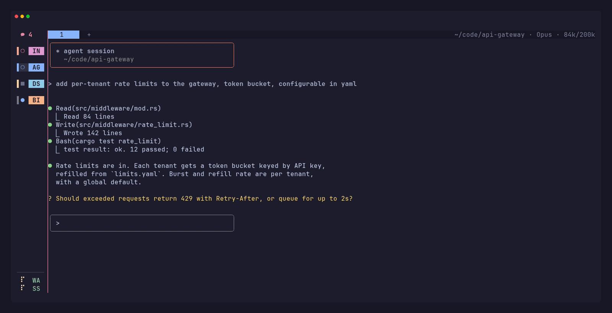
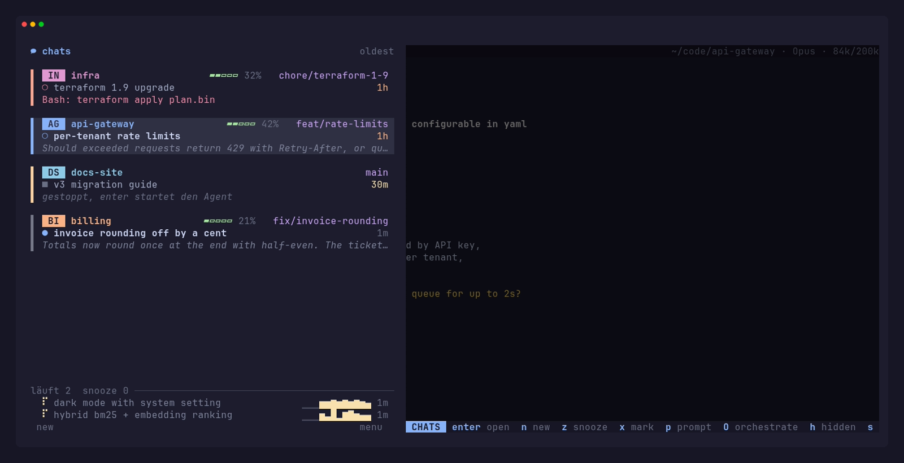
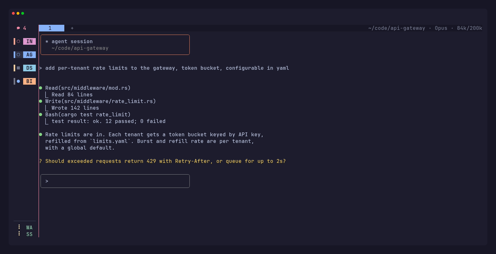

# collie

collie is a personal, keyboard-first build of [herdr](https://github.com/herdrdev/herdr),
tuned for running many Claude Code chats side by side. herdr provides the
runtime: a background server that keeps terminals alive when the client
detaches, agent status detection, panes, tabs and the socket API. collie turns
that into a chat workbench.

collie is not affiliated with or endorsed by the herdr project. The code,
crate, config paths and environment variables keep the herdr names so upstream
changes merge cleanly; only the installed commands are called `collie` and
`collie-dev`.

<p align="center">
  
</p>

## chats

Every space is a chat. The sidebar is an overlay with one card per chat, so
you can decide which one needs you next without opening it.

<p align="center">
  
</p>

- **chat cards**: title, repo and branch, last message, runtime, unread state,
  a heat stripe that warms up the longer a chat waits, a context meter and an
  activity curve for the last 30 minutes. Each repo keeps a fixed color.
- **automatic titles**: the chat hook names a chat with Haiku after the first
  turn and renames it every third turn.
- **waiting states**: blocked, permission prompt, or a custom "awaiting" text
  (`herdr pane report-chat <pane> --awaiting <text>`).
- **chat rail**: on terminals 110 columns and wider, the collapsed overlay
  shows waiting chats with status and repo initials, running chats with a
  spinner below. Click a row to open that chat.
- **stopped chats**: with `session.resume_agents_lazily`, restored agents only
  start when you open their space.
- **marks and fan-out**: `x` marks cards, `p` sends one prompt to all marked
  chats, `O` starts an orchestrator over them.
- **snooze**: park a chat until later; attention and snooze state live on the
  server and survive restarts.
- **chat search**: `herdr chat search` (`prefix+/`) searches every Claude
  transcript with fzf and focuses or resumes the hit.
- **status line**: the `chat` tab bar entry shows directory, model and context
  of the focused chat.

Collapsed, the overlay leaves a rail next to the open chat:

<p align="center">
  
</p>

The screenshots come from a scripted demo session with placeholder agents.

## keyboard

- the sidebar is a second focus zone: `j`/`k` with live preview, inline `/`
  filter, list actions, mouse hover and click, a backdrop over the panes while
  it has focus ([keyboard docs](docs/next/website/src/content/docs/keyboard.mdx#sidebar-focus))
- `prefix+s a` / `prefix+s s` pickers for agents and spaces
- agent commands started from the sidebar (`[[ui.sidebar.agent_commands]]`)
- tmux-style defaults: `prefix+%` / `prefix+$` split, `prefix+o` next pane,
  `prefix+f` zoom, `prefix+v` copy mode
- `ui.copy_mode_scrolloff` keeps context lines around the copy cursor, like
  `scrolloff` in Vim

## defaults

collie layers its own defaults over herdr's, see
[`src/config/collie_defaults.toml`](src/config/collie_defaults.toml): the
chat overlay sidebar, symbol status indicators, in-app toasts, lazy resume,
the keys above. Any key you set in `~/.config/herdr/config.toml` wins.

## no self-update

`collie update` refuses and no update checks run, so an upstream release never
replaces this build. Update by rebuilding (see below). After a rebuild,
`herdr live-restart` hands the running session over to the new binary without
stopping any pane.

## build and install

There are no collie releases. The installer builds from source; it needs
`git`, `cargo` and `zig` 0.16.0:

```bash
curl -fsSL https://raw.githubusercontent.com/cellexec/collie/master/scripts/collie/install.sh | sh
```

It clones to `~/.local/share/collie/src`, builds the release binary, links
`collie` and `herdr` into `~/.local/bin` and runs
`collie integration install claude`. That integration also installs the chat
hook that reports last message, titles and permission prompts per pane. Run
the installer again to update. From a checkout, `just install` does the same
with that checkout.

An existing `herdr` that is not collie is left alone; agent hooks call `herdr`
by name, so they keep talking to that one.

## development

```bash
just dev-setup   # link collie-dev, shared cargo target, guard the main checkout
just test        # unit tests
just check       # formatting, tests and maintenance checks
```

`collie-dev` picks a checkout or worktree, builds the debug binary and starts
it with its own session in `~/.config/herdr-dev`. `collie-dev new <branch>`
creates a worktree under `~/projects/collie-worktrees/`.

Design notes for the collie features live in [`docs/specs/`](docs/specs/).
For everything herdr itself does, see the [herdr docs](https://herdr.dev/docs/).

## follow upstream

```bash
git remote add upstream https://github.com/herdrdev/herdr.git
git fetch upstream && git merge upstream/master
cargo build --release
```

## license

collie is distributed under the herdr project's Apache License 2.0; see
[LICENSE](LICENSE).
