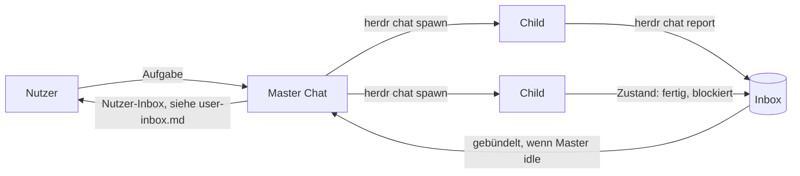

# Master Chat

Status: beschlossen, Umsetzung auf `feat/master-chat` (collie).
Ersetzt den Orchestrator aus `chat-workflow.md` (Abschnitt 6, Taste `O`).

Ein Master Chat nimmt Aufgaben an, verteilt sie an Child-Chats, sammelt deren
Rückmeldungen und legt dir gebündelt vor, was er nicht selbst entscheiden kann.
Children erscheinen nie in der Sidebar, nur im Telescope ihres Masters.



## Modell

| Fakt | Ort | Gespeichert |
| --- | --- | --- |
| Rolle `master` oder `child` | Server, Space | ja |
| Master eines Childs | Server, Space (`parent`) | ja |
| Auftrag eines Childs | Server, Space | ja |
| Inbox des Masters | Server, Space | ja |
| Telescope, Breadcrumb | TUI | nein |

- Mehrere Master sind erlaubt. Jeder verwaltet nur seine eigenen Children.
- Ein Master heißt fest `Master Chat`. Automatische Titel gelten für ihn nicht.

## Server-API

| Methode | Wirkung |
| --- | --- |
| `chat.master_create` | neuer Space `Master Chat`, startet `claude` mit dem Master-Startprompt |
| `chat.promote` | macht einen bestehenden Chat zum Master und schickt ihm den Startprompt |
| `chat.demote` | Master wird normaler Chat, seine Children kommen in die Hauptliste |
| `chat.adopt` | hängt Chats als Children an einen Master |
| `chat.spawn` | startet ein Child: neuer Space oder ein frisch angelegter Worktree-Space |
| `chat.stop` | beendet den Agent eines Childs, der Space bleibt als gestoppter Chat |
| `chat.resume` | startet den gestoppten Agent eines Childs |
| `chat.close` | schließt einen Master, die Children werden geschlossen oder übernommen |
| `chat.report` | Nachricht eines Childs (oder des Nutzers) an die Inbox des Masters |
| `chat.inbox` | Inbox eines Masters, offen oder vollständig |

- Startet collie einen Agent für einen Master (Master selbst, `spawn`,
  `resume`), beantwortet es 2 Minuten lang die Vertrauensfrage von Claude
  Code (`Yes, I trust this folder`) selbst. Abschalten mit
  `master.trust_child_folders = false`.
- `herdr chat spawn --worktree` merkt sich die offenen Spaces vor
  `worktree.create`. Legt `worktree.create` dabei einen Space für das
  Haupt-Repo an, schließt `chat.spawn` ihn wieder (`known_workspace_ids`),
  sonst bliebe er als leere Shell in der Chat-Liste.
- `chat.spawn` lehnt ab, wenn `master.max_running_children` (Default 6)
  laufende Children erreicht sind. Gestoppte Children zählen nicht.
- Aus einem Child-Pane lehnt der Server schreibende Methoden ab, die auf
  einen anderen Space zielen (`agent.prompt`, `agent.send_keys`,
  `pane.send_*`, `pane.run`, `chat.*`, `workspace.close`). Den Aufrufer
  erkennt der Server über die Prozess-ID am Socket. Lesen bleibt erlaubt.

## Inbox

| Eintrag | Auslöser |
| --- | --- |
| `report` | `herdr chat report <text>` aus dem Child |
| `done` | Agent des Childs hört auf zu arbeiten |
| `blocked` | Agent des Childs blockiert, etwa an einem Permission-Prompt |
| `user` | Nutzer schreibt im Telescope direkt an ein Child (`p`) |
| `restart` | nach einem Neustart: Liste der gestoppten Children |

- Der Server stellt offene Einträge gebündelt als ein Prompt zu, sobald der
  letzte Eintrag 5 Sekunden alt ist, der Master idle ist und der Nutzer seit
  5 Sekunden nicht im Master getippt hat.
- `herdr chat inbox [--all]` zeigt den Stand.

## CLI

```text
herdr chat master [--cwd DIR]                 neuer Master Chat
herdr chat promote [WORKSPACE]                Chat zum Master machen
herdr chat demote [WORKSPACE]
herdr chat spawn --prompt TEXT [--cwd DIR] [--worktree BRANCH [--base REF]]
                 [--title TEXT] [--agent claude]
herdr chat children                           Children des Masters
herdr chat stop|resume|close <CHILD>
herdr chat report <TEXT>                      aus dem Child an den Master
herdr chat inbox [--all]
```

Ohne Workspace-Argument gilt der Space aus `HERDR_PANE_ID`.

## Agent-Verhalten

- Der Skill `collie-master` beschreibt dem Master Aufgabenverteilung,
  Worktree-Regel, Stop und Close sowie gesammelte Rückfragen über `formular`.
  `collie integration install claude` installiert ihn.
- Jedes Child bekommt mit dem Auftrag ein Briefing: Master-ID, `herdr chat
  report`, keine Steuerung anderer Chats.
- Children mit Code-Änderungen in einem Repo bekommen einen eigenen Worktree
  (`--worktree`). Reine Lese- oder Rechercheaufgaben brauchen keinen.
- `stop` darf der Master selbst. `close` darf er, wenn das Child seinen
  Abschluss gemeldet hat. Sonst fragt er den Nutzer.
- Nach einem Neustart bleiben Children gestoppt. Der Master bekommt einen
  `restart`-Eintrag und setzt sie gezielt mit `herdr chat resume` fort.

## Sidebar

```
▌ 󰆥  Master Chat            4 Chats   ▰▰▱▱▱ 38%
▌ ● ⚠1 ⟳2 ✓1                                  3m
▌ Snooze-Fix: Migration jetzt oder später?
```

| Zeile | Inhalt |
| --- | --- |
| 1 | Krone, `Master Chat`, Zahl der Children, Kontext-Balken |
| 2 | Status des Masters, Children nach Status (blockiert, läuft, fertig), Wartezeit |
| 3 | `awaiting`, sonst letzte Inbox-Nachricht, sonst letzte Nachricht |

- Master-Karten stehen oben angepinnt und nehmen nicht an der Sortierung teil.
- Children fehlen in Liste, Rail und Linie. Ein blockiertes Child zählt auf
  der Linie als blockierter Master.
- Ist ein Child gerade offen, steht es als eingerückte Zeile unter seinem
  Master. Die Zeile verschwindet, sobald der Space verlassen wird.

## Telescope

Zentriertes Modal mit 90 % Größe. Auslöser: Klick auf `N Chats`, `m` auf der
Master-Karte, global `prefix+m` (zuletzt aktiver Master).

| St | Titel | Repo | Branch | Aktivität | Kontext | Idle seit | Letzte Nachricht / Grund |
| --- | --- | --- | --- | --- | --- | --- | --- |

- Sortierung: blockiert, dann wartend nach Wartezeit, dann laufend, dann
  gestoppt. `s` schaltet auf flach nach Wartezeit.
- Unter der Tabelle stehen Auftrag und letzte Nachricht des Childs ungekürzt.

| Taste | Wirkung |
| --- | --- |
| `j`/`k`, `g`/`G` | Cursor |
| `enter` | Child öffnen |
| `/` | Filter |
| `p` | Prompt direkt an das Child; der Master bekommt einen `user`-Eintrag |
| `x` | Child stoppen, gestopptes Child fortsetzen |
| `d` | Child schließen, mit Bestätigung |
| `s` | Sortierung umschalten |
| `esc` | Filter löschen, sonst schließen |

Ein geöffnetes Child zeigt in der Tab-Leiste den Breadcrumb
`󰆥 Master Chat › <Titel>`. Ein Klick auf `Master Chat` führt zurück.

## Master beenden

| Aktion | Children |
| --- | --- |
| Schließen | Dialog: Children schließen oder in die Hauptliste übernehmen |
| `demote` | werden normale Chats |
| Stoppen | laufen weiter, die Inbox staut sich |

## Sidebar-Tasten

| Taste | Wirkung |
| --- | --- |
| `O` ohne Markierung | Chat unter dem Cursor wird Master |
| `O` mit Markierung, Cursor auf Master | markierte Chats werden seine Children |
| `O` mit Markierung, Cursor nicht auf Master | neuer Master, markierte Chats werden Children |
| `M` | neuer Master Chat |
| `m` | Telescope des Masters unter dem Cursor |
