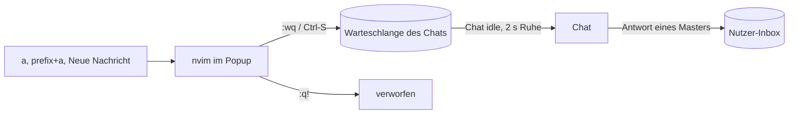

# Composer für neue Nachrichten

Status: umgesetzt (collie), Branch `feat/user-composer`. Ergänzt
`user-inbox.md` und `master-chat.md`.

Im Eingabefeld eines Master Chats landen auch die `[collie inbox]`-Prompts
der Children. Was du dort angefangen hast, ging mit dem nächsten Prompt
mit raus. Der Composer schreibt deine Nachricht in nvim und stellt sie zu
wie die Rückmeldungen der Children: erst, wenn der Chat idle ist.

## Auslöser

| Ort | Taste | Ziel |
| --- | --- | --- |
| Chat-Liste (Sheet, Sidebar) | `a` | Chat unter dem Cursor |
| überall | `prefix+a` | fokussierter Chat, sonst zuletzt besuchter oder erster Master |
| Tab-Leiste | Klick auf `󰏫 Neue Nachricht` | fokussierter Chat, nur mit laufendem Agent |

## Zustellung

| Fakt | Verhalten |
| --- | --- |
| Speicher | `user_replies` des Chats mit `message = true`, gespeichert wie Rückmeldungen |
| Wann | Chat idle oder fertig, letzte Rückmeldung 2 s alt, du hast 5 s nicht im Chat getippt |
| Reihenfolge | Nachrichten einzeln und vor den gebündelten Rückmeldungen, damit jede ihre Antwort bekommt |
| Prompt an einen Master | `[collie nutzer] Nachricht direkt von mir, nicht von einem Child:` und der Text |
| Prompt an andere Chats, Slash-Befehle | der Text unverändert, sonst erkennt Claude Code `/befehl` nicht |
| Antwort eines Masters | landet als `antwort` in der Nutzer-Inbox, Titel ist die erste Zeile der Nachricht |

## Server-API

| Methode | Wirkung |
| --- | --- |
| `chat.user_inbox_act` `compose` | öffnet nvim im Popup über dem aktuellen Space, im Verzeichnis des Chats |
| `chat.user_inbox_act` `message_written` | liest `path`, löscht die Datei und reiht den Text ein; leer heißt verworfen |
| `herdr chat user-inbox-result 0 --workspace W --message F` | ruft das Popup nach dem Beenden von nvim auf |

## nvim

`scripts/collie/nvim/collie-message.lua`, eingebettet ins Binary und beim
Öffnen nach `<data_dir>/user-inbox/collie-message.lua` geschrieben.

| Teil | Verhalten |
| --- | --- |
| Filetype | `colliemsg`, Syntax `markdown`, Winbar mit Ziel und Tasten |
| `/` am Zeilenanfang | Projekt- und Nutzer-Skills und -Commands, Plugin-Skills (`plugin:name`), eingebaute Befehle; Beschreibung aus dem Frontmatter |
| `@` | Dateien und Ordner aus `git ls-files`, sonst bis Tiefe 5; Fuzzy-Suche |
| `Tab`/`S-Tab`, `Enter` | im Menü blättern, übernehmen |
| `:wq`, `Ctrl-S` | schicken |
| `:q!` | verwerfen |
| andere Completion | blink.cmp (`b:completion = false`) und nvim-cmp sind im Puffer aus |
