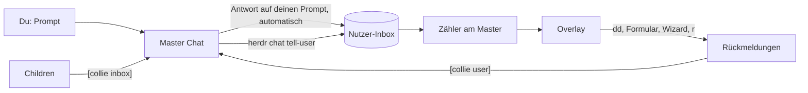

# Nutzer-Inbox

Status: umgesetzt auf `feat/user-inbox` (collie). Ergänzt `master-chat.md`.

Ein Master Chat bekommt laufend `[collie inbox]`-Prompts seiner Children.
Seine Antworten an dich rutschen dabei im Chat nach oben weg. Die
Nutzer-Inbox sammelt alles, was der Master dir sagen will, an einem eigenen
Ort, bis du es mit `dd` erledigst.

## Modell

| Fakt | Ort | Gespeichert |
| --- | --- | --- |
| Einträge der Nutzer-Inbox | Server, Master-Space (`user_inbox`) | ja |
| Rückmeldungen an den Master | Server, Master-Space (`user_replies`) | ja |
| Zähler und Revision | Snapshot (`team.user_inbox_*`) | nein |
| Overlay, Cursor, Markierungen, `u`-Verlauf | TUI | nein |

| Art | Quelle | Offen, solange |
| --- | --- | --- |
| `antwort` | Stop-Hook: Antwort auf einen Prompt, der nicht mit `[collie ` beginnt | ungelesen |
| `nachricht` | `herdr chat tell-user` | ungelesen |
| `formular` | `herdr chat tell-user --kind formular --file F` | nicht beantwortet |
| `wizard` | `herdr chat tell-user --kind wizard --file S` | nicht mit Exit-Code 0 durchgelaufen |

- Einträge sind wichtig oder optional (`--optional`). `antwort` ist immer
  wichtig.
- Ein Turn erzeugt eine `antwort`. Der Schlüssel ist die UUID des Prompts im
  Transcript; ein späterer Stop im selben Turn ersetzt den Text.
- Einträge verschwinden nur durch `dd`. Die letzten 50 gelöschten bleiben für
  `u` erhalten.

## Server-API

| Methode | Wirkung |
| --- | --- |
| `chat.tell_user` | legt `nachricht`, `formular` oder `wizard` ab |
| `chat.user_inbox` | nicht gelöschte Einträge |
| `chat.user_inbox_act` | `read`, `done`, `restore`, `open`, `reply`, `answered`, `wizard_result`, `reply_written`, `flush` |
| `pane.report_chat` | neue Felder `answer`, `answer_prompt`, `answer_key` vom Stop-Hook |

- `open` und `reply` teilen das Agent-Pane des Masters und tippen dort den
  Befehl ein: nvim für Formular und Rückfrage, `bash` für den Wizard. Das Pane
  meldet sein Ergebnis mit `herdr chat user-inbox-result`.
- Ein Formular gilt als beantwortet, wenn sich die Datei beim Speichern
  geändert hat. `:q` ohne Änderung lässt es offen.

## Rückmeldungen an den Master

| Auslöser | Zeile im Prompt | Zustellung |
| --- | --- | --- |
| `dd` auf Nachricht | `#3 nachricht „…“: abgearbeitet` | beim Verlassen des Overlays |
| `dd` auf offenes Formular | `…: verworfen, ohne Antwort gelöscht` | beim Verlassen des Overlays |
| `dd` auf Antwort | keine | – |
| Formular gespeichert | `…: beantwortet, die Antworten stehen in <datei>` | sofort |
| Wizard beendet | `…: durchgelaufen` oder `abgebrochen mit Exit-Code N` | sofort |
| `r` | `…: Rückfrage: <text>` | sofort |

- Der Server bündelt fällige Rückmeldungen zu einem Prompt
  `[collie user] Rückmeldungen aus meiner Inbox:`, sobald der Master idle ist,
  die letzte Rückmeldung 2 Sekunden alt ist und der Nutzer seit 5 Sekunden
  nicht im Master getippt hat.
- `dd`-Meldungen warten, bis die TUI `flush` schickt, spätestens 30 Minuten.
- Bekommt ein Master im selben Durchlauf seine Child-Inbox, folgen die
  Rückmeldungen beim nächsten Idle.

## TUI

| Ort | Anzeige |
| --- | --- |
| Master-Karte, Zeile 2 | `󰇮 3 2`: wichtig rot, optional grau; Klick öffnet die Inbox |
| schmale Liste | `󰇮3` rechts am Master |
| Overlay | Gruppen Wichtig und Optional, neueste zuerst; darunter der Text des Eintrags |

| Taste | Wirkung |
| --- | --- |
| `I` auf Master oder Child, `prefix+i` | Inbox öffnen |
| `j`/`k`, `g`/`G`, Mausrad | Cursor; beim Lesen scrollen |
| `enter` | Nachricht lesen (Vollbild), Formular in nvim öffnen, Wizard starten |
| `space`, `m` | markieren |
| `d` `d` | markierte oder aktuelle Einträge erledigen; das erste `d` streicht sie rot durch |
| `u` | letztes `dd` zurückholen |
| `r` | Rückfrage in nvim |
| `ctrl+d`/`ctrl+u`, Bild auf/ab | Text scrollen |
| `esc`, `q` | schließen, zurückgehaltene Rückmeldungen gehen raus |

Der Zähler zählt ungelesene Nachrichten und Antworten sowie offene Formulare
und Wizards. Es gibt keinen Toast und keinen Ton.

## Agent-Verhalten

- Der Skill `collie-master` schreibt vor, Formulare und Wizards nur noch über
  die Inbox abzulegen und nie selbst zu öffnen.
- Neue Hook-Felder und Skill kommen mit `collie integration install claude`.
