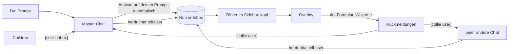

# Nutzer-Inbox

Status: umgesetzt (collie), global seit `feat/global-user-inbox`. Ergänzt
`master-chat.md`.

Ein Master Chat bekommt laufend `[collie inbox]`-Prompts seiner Children.
Seine Antworten an dich rutschen dabei im Chat nach oben weg. Die
Nutzer-Inbox sammelt alles, was Chats dir sagen wollen, an einem eigenen Ort,
bis du es mit `dd` erledigst. Es gibt eine Inbox für alle Chats.

## Modell

| Fakt | Ort | Gespeichert |
| --- | --- | --- |
| Einträge der Nutzer-Inbox | Server, Space des schreibenden Chats (`user_inbox`) | ja |
| Rückmeldungen an den Chat | Server, derselbe Space (`user_replies`) | ja |
| Zähler und Revision über alle Chats | Snapshot (`user_inbox`) | nein |
| Overlay, Cursor, Markierungen, `u`-Verlauf | TUI | nein |

| Art | Quelle | Offen, solange |
| --- | --- | --- |
| `antwort` | Stop-Hook: Antwort auf einen Prompt, der nicht mit `[collie ` beginnt | ungelesen |
| `nachricht` | `herdr chat tell-user` | ungelesen |
| `formular` | `herdr chat tell-user --kind formular --file F` | nicht beantwortet |
| `wizard` | `herdr chat tell-user --kind wizard --file S` | nicht mit Exit-Code 0 durchgelaufen |

- Einträge sind wichtig oder optional (`--optional`). `antwort` ist immer
  wichtig.
- Ein Turn erzeugt eine `antwort`. Der Schlüssel ist die UUID des Prompts im
  Transcript; ein späterer Stop im selben Turn ersetzt den Text.
- Einträge verschwinden durch `dd`. Beantwortete Formulare und mit Exit-Code
  0 durchgelaufene Wizards verschwinden sofort. Die letzten 50 gelöschten
  bleiben für `u` erhalten.
- Gespeichert wird je Chat, damit Rückmeldungen beim richtigen Agent
  ankommen. IDs sind nur je Chat eindeutig; die TUI adressiert Einträge mit
  Workspace-ID und ID.

## Server-API

| Methode | Wirkung |
| --- | --- |
| `chat.tell_user` | legt `nachricht`, `formular` oder `wizard` ab |
| `chat.user_inbox` | nicht gelöschte Einträge eines Chats; mit `all` aller Chats, je mit `workspace_id`, `chat` und `master` |
| `chat.user_inbox_act` | `read`, `done`, `restore`, `open`, `reply`, `answered`, `wizard_result`, `reply_written`, `flush`; mit `all` kommt die globale Liste zurück und `flush` gilt für alle Chats |
| `pane.report_chat` | neue Felder `answer`, `answer_prompt`, `answer_key` vom Stop-Hook |

- `open` und `reply` öffnen einen Tab im Inbox-Space und tippen dort den
  Befehl ein: nvim für Formular und Rückfrage, `bash` für den Wizard. Der Tab
  meldet sein Ergebnis mit `herdr chat user-inbox-result` und schließt sich.
- Der Inbox-Space entsteht beim ersten `open` (Name `Inbox`, Merkmal
  `user_inbox_space`) und verschwindet mit seinem letzten Tab. Er steht weder
  in der Chat- noch in der Space-Liste. Ist eine Aufgabe schon offen, springt
  `open` zu ihrem Tab.
- Ein Formular gilt als beantwortet, wenn sich die Datei beim Speichern
  geändert hat. `:q` ohne Änderung lässt es offen.

## Rückmeldungen an den Chat

| Auslöser | Zeile im Prompt | Zustellung |
| --- | --- | --- |
| `dd` auf Nachricht | `#3 nachricht „…“: abgearbeitet` | beim Verlassen des Overlays |
| `dd` auf offenes Formular | `…: verworfen, ohne Antwort gelöscht` | beim Verlassen des Overlays |
| `dd` auf Antwort | keine | – |
| Formular gespeichert | `…: beantwortet, die Antworten stehen in <datei>` | sofort |
| Wizard beendet | `…: durchgelaufen` oder `abgebrochen mit Exit-Code N` | sofort |
| `r` | `…: Rückfrage: <text>` | sofort |

- Der Server bündelt fällige Rückmeldungen zu einem Prompt
  `[collie user] Rückmeldungen aus meiner Inbox:`, sobald der Chat idle ist,
  die letzte Rückmeldung 2 Sekunden alt ist und der Nutzer seit 5 Sekunden
  nicht im Chat getippt hat.
- `dd`-Meldungen warten, bis die TUI `flush` schickt, spätestens 30 Minuten.
- Bekommt ein Master im selben Durchlauf seine Child-Inbox, folgen die
  Rückmeldungen beim nächsten Idle.

## TUI

| Ort | Anzeige |
| --- | --- |
| Sidebar-Kopf neben `󰭹 chats` | `󰇮 3 2`: wichtig rot, optional grau; Klick öffnet die Inbox |
| eingeklappte Sidebar (Leiste) | `󰇮 3 2` unter der Zahl der Chats; Master zeigen die Krone statt des Kürzels |
| Inbox offen | fast volle Breite, links die Tabelle (Markierung, Status, Art, Chat, Titel, Alter; wichtig zuerst, neueste zuerst), rechts der Text als gesetztes Markdown; rechts bleibt ein Streifen frei, ein Klick dorthin schließt |
| Aufgabe läuft | die Liste dockt links an, die Panes rücken nach rechts; Tastatur und Panes gehören dem Tab im Inbox-Space |
| Aufgabe fertig | schließt sich ihr Tab, ist die Inbox wieder ganz offen; wechselst du in einen anderen Space, schließt sie |

| Taste | Wirkung |
| --- | --- |
| `I` in der Sidebar, `prefix+i` | Inbox öffnen |
| `j`/`k`, `g`/`G`, Mausrad | Cursor; beim Lesen scrollen |
| `enter` | Nachricht lesen (Fokus auf den Text), Formular oder Wizard als Tab öffnen |
| `prefix+i`, Klick auf die angedockte Liste | während einer Aufgabe zurück in die Inbox |
| `space`, `m` | markieren; die erste Spalte zeigt dann eine Checkbox |
| `d` `d` | markierte oder aktuelle Einträge erledigen; das erste `d` streicht sie rot durch |
| `u` | letztes `dd` zurückholen |
| `r` | Rückfrage in nvim |
| `ctrl+d`/`ctrl+u`, Bild auf/ab | Text scrollen |
| `esc`, `q` | schließen und zurück in den Chat, aus dem die Inbox kam; zurückgehaltene Rückmeldungen gehen raus |

Der Zähler zählt ungelesene Nachrichten und Antworten sowie offene Formulare
und Wizards. Es gibt keinen Toast und keinen Ton.

## Agent-Verhalten

- Der Skill `collie-master` schreibt vor, Formulare und Wizards nur noch über
  die Inbox abzulegen und nie selbst zu öffnen.
- Jeder andere Chat darf `herdr chat tell-user` ebenso nutzen.
- Neue Hook-Felder und Skill kommen mit `collie integration install claude`.
